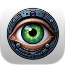

<!-- markdownlint-disable no-inline-html descriptive-link-text -->
# VizCE

  
  
  
  
   
  
   
  <a href="https://github.com/pierow2k/VizCE/releases">
    <strong>Download</strong>
  </a> · <a href="https://github.com/pierow2k/VizCE/commits">Commits</a>

Extract text from images, videos, QR codes, barcodes and colors with a
simple snip mechanism.

<!-- TABLE OF CONTENTS -->

  

    <h2 style="display: inline-block">Table of Contents</h2>
  

- [About this fork](#about-this-fork)
  - [Differences from upstream](#differences-from-upstream)
  - [Differences to be aware of](#differences-to-be-aware-of)
- [Features](#features)
- [Preview](#preview)
  - [Text Extraction Demo](#text-extraction-demo)
  - [QR/Barcode Extraction Demo](#qrbarcode-extraction-demo)
  - [Color Picker Demo](#color-picker-demo)
  - [History View](#history-view)
- [Requirements](#requirements)
- [Getting VizCE](#getting-vizce)
  - [Releases](#releases)
  - [Building locally](#building-locally)
- [License](#license)

## About this fork

**VizCE (Community Edition)** is an independently maintained fork of
[Viz](https://github.com/alienator88/Viz).

The original project is currently
[on indefinite hold](https://github.com/alienator88/Viz#project-status-on-hold)
for feature development, pull-request reviews, and new releases. VizCE
continues development of the application, preserving its core functionality
while addressing bugs, improving reliability and usability, and maintaining
compatibility with modern versions of macOS.

*VizCE is neither affiliated with nor maintained by the original Viz author.*

Details

### Differences from upstream

VizCE builds upon the original application with a growing number of
improvements:

- **Bug fixes and reliability.** Fixes for issues affecting screen
  capture, webcam operation, text recognition, previews, application
  settings, and history management.
- **Interface and usability.** Improvements to window layouts, keyboard
  accessibility, error handling, and responsiveness.
- **Performance and stability.** Improved handling of background
  operations, camera sessions, text processing, and history storage.
- **Modernization and maintainability.** Updated Swift and SwiftUI code,
  reorganized project structure, and additional regression tests to
  support ongoing development.
- **Independent identity.** Renamed to VizCE, with a distinct application
  icon, bundle identifier, and build configuration.

### Differences to be aware of

VizCE retains the core functionality of the original application, with
a few important differences:

- **Code signing and installation.** VizCE releases are ad-hoc signed
  rather than signed with an Apple Developer ID certificate and are not
  notarized. Consequently, macOS Gatekeeper may prevent downloaded
  releases from opening normally. Users can build VizCE from source or
  use a utility such as [Sentinel](https://github.com/alienator88/Sentinel)
  to manage macOS quarantine restrictions.
- **iCloud synchronization is not supported.** The original iCloud
  configuration was tied to the upstream developer's Apple account.
  VizCE maintains history locally.
- **Existing application data is not migrated.** VizCE uses its own
  application identity and history storage, separate from the original
  Viz installation.

For a detailed record of changes, see the [Changelog](CHANGELOG.md).

### Missing Icons Example

## Features

- Very quick extraction process (Can set fidelity between fast and
  accurate as per the Apple Vision framework)
- Can extract text based on all languages or select your language in
  settings for quicker/accurate captures
- Copies to clipboard automatically, ready to paste
- Post-processing option to execute shell commands when capture is
  taken. Pass captured text as a whole argument using `[ocr]`,
  `"[ocr]"`, or `'[ocr]'` (for example,
  `say [ocr]; echo [ocr] > capture.txt`). Captured text is passed as
  data. Templates using placeholders support ordinary commands,
  pipelines, separators, and redirections. Embedded placeholders,
  substitutions, heredocs, compound statements, and braced parameter
  expressions are unsupported; move those operations into a separate
  script that accepts the text as an argument. Templates without
  placeholders run unchanged.
- Post-processing also exposes captured text as `VIZCE_OCR_TEXT`, for
  example `printf '%s' "$VIZCE_OCR_TEXT"`. No legacy environment-variable
  alias is supplied.
- Customizable hotkeys for the main app functions
- Shows copied text in a floating window, which can be set to auto-hide
  as well after a custom wait period
- Enable or disable line breaks in the extracted text
- Append multiple text snippets to the clipboard by enabling Append
  option in Settings, otherwise it only holds one snippet at a time
- Saves captures in History and persists app restarts
- History is stored locally; this fork does not synchronize history
  with iCloud
- Launch at login option
- Custom auto-updater that pulls latest release notes and binaries
  from GitHub Releases

## Preview

### Text Extraction Demo

https://github.com/user-attachments/assets/b3faf621-6283-4657-a43e-28eb2555ce56

### QR/Barcode Extraction Demo

https://github.com/user-attachments/assets/09be00cf-5568-4a8c-a3c3-349b5288420a

### Color Picker Demo

https://github.com/user-attachments/assets/1e4d7331-0cf6-4467-9977-22b63a593d87

### History View

## Requirements

- macOS 14.0 or later.

## Getting VizCE

### Releases

Pre-compiled, always up-to-date versions are available from the
[releases](https://github.com/pierow2k/VizCE/releases) page.

**Code signing and installation.** VizCE releases are ad-hoc signed
rather than signed with an Apple Developer ID certificate and are not
notarized. Consequently, macOS Gatekeeper may prevent downloaded
releases from opening normally. Use a utility such as
[Sentinel](https://github.com/alienator88/Sentinel) to manage macOS
quarantine restrictions.

### Building locally

Refer to [BUILDING.md](BUILDING.md)

## License

The original project's license notice and attribution are retained below.

> [!IMPORTANT]
> Viz is licensed under Apache 2.0 with [Commons Clause](https://commonsclause.com/). This means that you can do anything you'd like with the source, modify it, contribute to it, etc., but the license explicitly prohibits any form of monetization for Viz or any modified versions of it. See full license [HERE](https://github.com/alienator88/Sentinel/blob/main/LICENSE.md)
